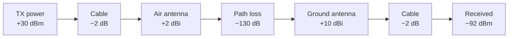

# RF Basics: dB, dBm, dBi and mW

Radio specifications use three related units: dB, dBm and dBi. This page shows what each one means and how to convert them to milliwatts in your head. It also shows how to use them to estimate the range of a radio link.

The key idea: **dB is not a unit of power. It is a ratio, written as a logarithm, so that multiplication becomes addition.**

---

## The Three Units

| Unit | What it is | Example |
|---|---|---|
| **dB** | A ratio between two values. It has no unit. | "+3 dB" = 2 times more. "The cable loses 2 dB." |
| **dBm** | An absolute power, relative to **1 mW**. | 0 dBm = 1 mW. 30 dBm = 1 W. |
| **dBi** | Antenna gain, relative to an ideal **isotropic** antenna that radiates equally in all directions. | 2 dBi whip, 10 dBi Yagi. |

The letter after "dB" names the reference: **m** = milliwatt, **i** = isotropic. A plain "dB" is a change only.

> **dBm ± dB = dBm.**
> Start from a power and add or subtract gains and losses. Never add dBm to dBm.

---

## Two Numbers to Remember

- **+3 dB = ×2**, and −3 dB = ÷2
- **+10 dB = ×10**, and −10 dB = ÷10

All other values come from these two:

| dB | Factor | How to get it |
|---|---|---|
| 0 | 1 | |
| 1 | ≈ 1.25 | 10 − 9 → 10 ÷ 8 |
| 3 | 2 | |
| 6 | 4 | 3 + 3 → 2 × 2 |
| 7 | 5 | 10 − 3 → 10 ÷ 2 |
| 9 | 8 | 3 + 3 + 3 |
| 10 | 10 | |
| 13 | 20 | 10 + 3 → 10 × 2 |
| 20 | 100 | 10 + 10 |
| 30 | 1000 | 10 + 10 + 10 |

---

## dBm and mW

Use the decade anchors: **0 dBm = 1 mW, 10 dBm = 10 mW, 20 dBm = 100 mW, 30 dBm = 1 W**. Between the anchors, step by 3 dB (×2).

| dBm | Power | Typical use |
|---|---|---|
| −9 | 0.125 mW | Minimum setting of SX126x LoRa chips |
| 0 | 1 mW | |
| 10 | 10 mW | |
| 14 | 25 mW | Common legal limit for 868 MHz ISM devices |
| 20 | 100 mW | Typical RC link (ELRS, Crossfire) |
| 22 | ≈ 160 mW | Maximum output of an SX1262/SX1268 chip |
| 27 | 500 mW | |
| 30 | **1 W** | LoRa module with external PA, for example EBYTE E22-400M30S |
| 33 | 2 W | |

Conversion formulas for when the mental steps are not enough:

- mW = 10<sup>(dBm / 10)</sup>
- dBm = 10 × log<sub>10</sub>(mW)

> **Module power is not chip power.** On modules with an external power amplifier (PA), the "TX power" register sets the chip, not the antenna output. Example: with the SX1268 chip at 22 dBm, the E22-400M30S gives about 30 dBm (1 W) at the antenna. Read the module datasheet, not the chip datasheet.

---

## Received Signals Are Negative dBm

Received power is very small, so it is a negative number in dBm.

| dBm | Power | Meaning |
|---|---|---|
| −30 | 1 µW | Very strong, antennas almost touching |
| −50 | 10 nW | Strong, bench test at short distance |
| −60 | 1 nW | |
| −90 | 1 pW | Good long-range link |
| −120 | 1 fW | Near the sensitivity limit of LoRa |

Every −30 dB is a further factor of 1000 down. A transmitter at 30 dBm and a receiver at −120 dBm are 150 dB apart: a factor of 10<sup>15</sup>. That is why we use logarithms.

---

## Antenna Gain (dBi)

An antenna does not add energy. It **concentrates** the power in some directions and takes it from other directions. Think of a flashlight with a reflector: the bulb is the same, but the beam is narrower and brighter.

- **2 dBi** whip or dipole: a donut-shaped pattern with little focus.
- **5–8 dBi** collinear: a flatter donut, more gain at the horizon, less above and below.
- **10–15 dBi** Yagi or patch: about 10–30 times more power in the beam, and little to the sides. You must point it.
- Antenna gain counts **on both ends** of the link, for transmit and for receive.
- **dBd** is gain relative to a dipole: dBi = dBd + 2.15.

---

## Link Budget: Add Everything

Write each element of the link as a gain (+) or a loss (−), and add them. The result is the received power. Compare it with the receiver sensitivity.



```
  +30 dBm   TX power (1 W module)
  − 2 dB    cable and connectors
  + 2 dBi   air antenna
  −130 dB   path loss: about 120 dB free space at 50 km and 450 MHz, plus 10 dB terrain and Fresnel loss
  +10 dBi   ground Yagi
  − 2 dB    ground cable
  ───────
  −92 dBm   received power

  −121 dBm  receiver sensitivity (LoRa SF7, BW 250 kHz)
  ───────
   29 dB    margin
```

The **margin** is your reserve against fading, foliage, bad antenna orientation and interference. Keep at least 10–20 dB.

---

## Distance in dB

Free-space path loss (FSPL):

FSPL (dB) = 32.45 + 20 × log<sub>10</sub>(f in MHz) + 20 × log<sub>10</sub>(d in km)

| Distance | FSPL at 450 MHz | FSPL at 900 MHz | FSPL at 2.4 GHz |
|---|---|---|---|
| 1 km | 85.5 dB | 91.5 dB | 100 dB |
| 10 km | 105.5 dB | 111.5 dB | 120 dB |
| 50 km | 119.5 dB | 125.5 dB | 134 dB |
| 100 km | 125.5 dB | 131.5 dB | 140 dB |

Rules of thumb:

- **2 × distance = +6 dB path loss.** This is the inverse-square law (6 dB = ×4).
- **10 × distance = +20 dB path loss.**
- **2 × frequency = +6 dB path loss** for the same antenna gain. Lower bands go further with the same power.
- **+6 dB of budget = 2 × free-space range.** 4 × power doubles the range. 2 × power (+3 dB) gives only about 1.4 × range.

A better antenna is usually the cheapest upgrade. Going from a 2 dBi to a 10 dBi ground antenna is +8 dB, about 2.5 × range, in both directions. To get the same from power, you need about 6 times more transmit power, and that helps only one direction.

---

## LoRa Sensitivity and SNR

LoRa receivers can decode signals below the noise floor. The limit depends on the spreading factor (SF) and the bandwidth (BW).

| SF | Lowest SNR that decodes | Sensitivity, BW 125 kHz | Sensitivity, BW 250 kHz |
|---|---|---|---|
| SF6 | −5 dB | −118 dBm | −115 dBm |
| SF7 | −7.5 dB | −124 dBm | −121 dBm |
| SF8 | −10 dB | −127 dBm | −124 dBm |
| SF9 | −12.5 dB | −129.5 dBm | −126.5 dBm |
| SF10 | −15 dB | −132 dBm | −129 dBm |
| SF12 | −20 dB | −137 dBm | −134 dBm |

- Each step up in SF gives about 2.5 dB more sensitivity, and doubles the time on air.
- 2 × bandwidth costs 3 dB of sensitivity, and halves the time on air.
- Fast links with low latency (RC control, telemetry at 10–20 Hz) use low SF and wide BW. Slow links with long range use high SF.
- To find the SF of an unknown link: weaken the link slowly and watch the reported SNR. The lowest SNR at which packets still arrive shows the SF.

Values are typical for Semtech SX126x chips. Read the datasheet of your module.

---

## Range Limits Beyond the Budget

A large link budget does not guarantee range. At long distance, these limits usually come first:

- **Radio horizon.** The Earth's curvature blocks the path. With a 2 m ground antenna: about 47 km at 100 m altitude, 77 km at 300 m, 136 km at 1000 m.
  Radio horizon (km) ≈ 4.12 × (√h<sub>1</sub> + √h<sub>2</sub>), with h in metres.
- **Fresnel zone.** The path needs clear space around the line of sight, not only the line itself. At 450 MHz and 50 km, the zone radius at mid-path is about 90 m. Terrain or trees in this zone add loss.
- **Interference and jamming.** A higher noise floor reduces the margin directly. 10 dB of extra noise costs as much as 10 times less transmit power.

---

## Cheat Sheet

> **dB is a change. dBm is an amount: 0 dBm = 1 mW, 30 dBm = 1 W. dBi is antenna focus.**
> **+3 dB = ×2, +10 dB = ×10, +6 dB = 2 × range.**
> **Add everything, then compare with the receiver sensitivity.**
